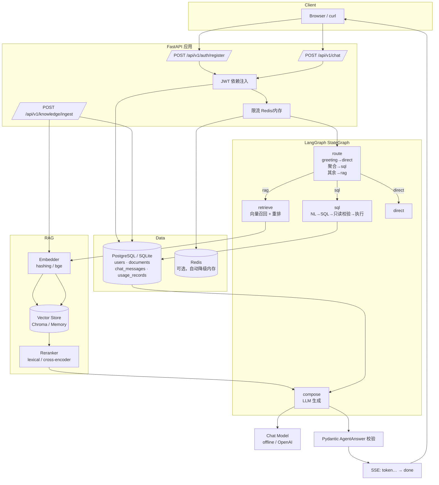

# Personal KB Agent · 个人知识库问答 Agent

一个可直接部署的个人知识库问答服务：**FastAPI + LangGraph StateGraph + 向量检索/重排 + NL2SQL**，
带 JWT 鉴权、SSE 流式输出、Token 成本台账与 Docker Compose 一键启动。

> 定位：求职作品 / 生产级 RAG 骨架。所有 Agent 产出必须通过 Pydantic 模式校验才会返回用户。

---

## 目录

- [核心能力](#核心能力)
- [架构](#架构)
- [技术栈](#技术栈)
- [快速开始](#快速开始)
- [接口示例](#接口示例)
- [SSE 事件协议](#sse-事件协议)
- [环境变量](#环境变量)
- [项目结构](#项目结构)
- [设计取舍](#设计取舍)
- [测试](#测试)
- [路线图](#路线图)

---

## 核心能力

| 能力 | 说明 |
|---|---|
| 对话问答 | 检索知识库 → 重排 → 生成，答案附**可追溯引用** |
| 流式输出 | SSE 逐 token 推送，首字延迟低；`stream=false` 可切一次性 JSON |
| NL2SQL | 统计类问题自动翻译成**只读** SQL 并执行，返回原始结果行 |
| 鉴权 | bcrypt 密码哈希 + JWT Bearer；注册即签发 Token |
| 成本可控 | 每次调用记录 prompt/completion token 与估算 USD 成本；上下文只带最近 N 轮 |
| 韧性 | 所有外部 I/O 强制超时 + 指数退避重试，失败降级而非 5xx |
| 可替换 | 向量库（Chroma/Qdrant/Pinecone）、Embedding、Reranker、LLM 均为可插拔实现 |

**零 Key 可跑**：默认 `LLM_PROVIDER=fake` 使用离线确定性模型，不需要任何 API Key
就能跑通全链路、跑通测试、看到流式效果。切真实模型只需改环境变量。

---

## 架构



**请求时序（RAG 路线）**

```
client ──POST /chat──▶ auth ─▶ rate limit ─▶ load last N turns ─▶ route
                                                                  │
                        ┌─────────────────────────────────────────┘
                        ▼
              retrieve → rerank → 组装 context  → LLM 流式生成
                        │                         │
                        │                         ├─ token 事件逐个下发 ─▶ client
                        ▼                         ▼
                    citations ─────────────▶ AgentAnswer 校验 ─▶ 落库 + 计费 ─▶ done 事件
```

---

## 技术栈

| 层 | 选型 | 备注 |
|---|---|---|
| Web | FastAPI（异步）+ Uvicorn | 自动 OpenAPI，`/docs` 可直接调试 |
| Agent 编排 | LangGraph `StateGraph` | 条件边路由，节点职责单一 |
| RAG | 向量召回 + 重排 | Embedding / 向量库 / Reranker 三层可替换 |
| 向量库 | Chroma（默认） | 装不上或缺依赖时自动降级为进程内实现 |
| 关系库 | PostgreSQL + SQLAlchemy 2.0 | 异步驱动 asyncpg；本地默认 SQLite |
| 迁移 | Alembic | `alembic upgrade head` |
| 缓存/限流 | Redis | 连不上自动降级内存，`/health` 会标 degraded |
| 认证 | JWT（PyJWT）+ bcrypt | 不使用 passlib，规避其与 bcrypt 4.x 的兼容问题 |
| 流式 | SSE + `stream_mode="messages"` | 关闭 nginx 缓冲（`X-Accel-Buffering: no`） |
| 测试 | pytest + pytest-asyncio + httpx | 覆盖认证、RAG、NL2SQL、SSE、守卫 |
| 部署 | Docker Compose | api + postgres + redis |

---

## 快速开始

### 方式一：Docker Compose（一键）

```bash
cp .env.example .env
docker compose up --build -d
docker compose logs -f api
```

服务就绪后：

- Swagger UI: <http://localhost:8000/docs>
- 健康检查: <http://localhost:8000/health>

首次启动会自动执行 `alembic upgrade head` 建表，并灌入 4 篇演示语料。

### 方式二：本地开发

```bash
python -m venv .venv
# Windows
.venv\Scripts\activate
# macOS / Linux
source .venv/bin/activate

pip install -r requirements.txt
cp .env.example .env

# 启动（默认 SQLite + 内存向量库 + 离线模型，无需任何外部依赖）
uvicorn app.main:app --reload --port 8000
```

想用真实大模型：

```bash
pip install -r requirements-llm.txt
# .env 里设置 LLM_PROVIDER=openai、LLM_API_KEY=sk-xxx
```

### 冒烟验证

```bash
# 1) 注册拿 Token
TOKEN=$(curl -s -X POST http://localhost:8000/api/v1/auth/register \
  -H "Content-Type: application/json" \
  -d '{"email":"demo@example.com","password":"sup3rsecret!"}' | python -c "import sys,json;print(json.load(sys.stdin)['access_token'])")

# 2) 流式对话
curl -N -X POST http://localhost:8000/api/v1/chat \
  -H "Authorization: Bearer $TOKEN" \
  -H "Content-Type: application/json" \
  -d '{"message":"重排序是怎么工作的？","stream":true}'
```

---

## 接口示例

### 注册 / 登录

```bash
curl -X POST http://localhost:8000/api/v1/auth/register \
  -H "Content-Type: application/json" \
  -d '{"email":"demo@example.com","password":"sup3rsecret!"}'
```

```json
{
  "access_token": "eyJhbGciOiJIUzI1NiIs...",
  "token_type": "bearer",
  "expires_in": 86400,
  "user": {"id": "9f2c...", "email": "demo@example.com", "is_active": true, "created_at": "2026-11-10T07:10:00Z"}
}
```

### 非流式提问

```bash
curl -X POST http://localhost:8000/api/v1/chat \
  -H "Authorization: Bearer $TOKEN" \
  -H "Content-Type: application/json" \
  -d '{"message":"重排序是怎么工作的？","stream":false}'
```

```json
{
  "conversation_id": "0b9c...",
  "message_id": "4d1e...",
  "answer": "围绕「重排序是怎么工作的？」，知识库中《RAG 链路说明》给出了以下要点：\n\n1. 检索增强生成分为两阶段：第一阶段用向量库做粗召回，默认取前 8 个片段...",
  "route": "rag",
  "citations": [
    {"chunk_id": "a1b2...", "document_id": "7c3d...", "title": "RAG 链路说明", "source": "demo", "snippet": "检索增强生成分为两阶段...", "score": 0.87}
  ],
  "sql": null,
  "rows": null,
  "confidence": 0.87,
  "needs_clarification": false,
  "usage": {"model": "offline-deterministic", "prompt_tokens": 412, "completion_tokens": 96, "total_tokens": 508, "cost_usd": 0.00012, "latency_ms": 38}
}
```

### 自然语言触发 SQL

```bash
curl -X POST http://localhost:8000/api/v1/chat \
  -H "Authorization: Bearer $TOKEN" \
  -H "Content-Type: application/json" \
  -d '{"message":"知识库里一共有多少篇文档？","stream":false}'
```

```json
{
  "route": "sql",
  "sql": "SELECT count(*) AS total_documents FROM documents",
  "rows": [{"total_documents": 4}],
  "answer": "针对「知识库里一共有多少篇文档？」，我把问题转换成了只读 SQL 并执行，共返回 1 行结果：\n\n- {'total_documents': 4}",
  "citations": []
}
```

### 上传文档

```bash
curl -X POST http://localhost:8000/api/v1/knowledge/ingest \
  -H "Authorization: Bearer $TOKEN" \
  -H "Content-Type: application/json" \
  -d '{"title":"团队规范","content":"提交前必须跑 pytest。","source":"wiki"}'
```

### 其他

| 方法 | 路径 | 说明 |
|---|---|---|
| GET | `/health` | 依赖健康度（db / 向量库 / 缓存 / llm） |
| GET | `/health/live` | 存活探针，不碰外部依赖 |
| GET | `/api/v1/auth/me` | 当前用户 |
| GET | `/api/v1/chat/usage` | Token 与成本汇总 |
| GET | `/api/v1/chat/history/{conversation_id}` | 回看会话 |
| POST | `/api/v1/knowledge/search` | 只跑检索链路（含重排） |
| GET | `/api/v1/knowledge/stats` | 索引与检索配置概览 |

---

## SSE 事件协议

`POST /api/v1/chat`（`stream=true`）返回 `text/event-stream`：

```
event: start
data: {"conversation_id":"0b9c...","model":"offline-deterministic"}

event: token
data: {"t":"围绕「重排序是怎么工作的？」，知识库中"}

event: token
data: {"t":"《RAG 链路说明》给出了以下要点："}

event: done
data: {"conversation_id":"0b9c...","message_id":"4d1e...","answer":"...","route":"rag","citations":[...],"usage":{...}}
```

| 事件 | 时机 | 载荷 |
|---|---|---|
| `start` | 流开始 | `conversation_id`, `model` |
| `token` | 每个增量 | `{"t": "文本片段"}` |
| `done` | 正常结束 | 完整 `ChatResponse`（含引用、SQL、rows、usage） |
| `error` | 异常 | `{"code","message"}`，客户端应停止拼接 |

前端对接要点：`done` 覆盖所有结构化字段，`token` 只用于实时打字效果；
若中途收到 `error`，丢弃已拼接内容并提示重试。

---

## 环境变量

完整清单见 [`.env.example`](.env.example)。关键项：

| 变量 | 默认 | 说明 |
|---|---|---|
| `SECRET_KEY` | 占位值 | **生产必须替换**（`secrets.token_urlsafe(48)`） |
| `DATABASE_URL` | `sqlite+aiosqlite:///./data/app.db` | Compose 下覆盖为 PostgreSQL |
| `AUTO_CREATE_TABLES` | `true` | 生产设 `false`，改用 Alembic |
| `REDIS_URL` | 空 | 留空 = 进程内存缓存 |
| `VECTOR_BACKEND` | `auto` | `auto` / `chroma` / `memory` |
| `EMBEDDING_PROVIDER` | `hashing` | 切 `sentence-transformers` 需额外装包 |
| `RAG_TOP_K` / `RAG_RERANK_TOP_N` | `8` / `3` | 粗召回条数 / 精排保留条数 |
| `LLM_PROVIDER` | `fake` | `fake` = 离线确定性；`openai` = 真实模型 |
| `HISTORY_MAX_TURNS` | `6` | 上下文窗口（轮），防止成本失控 |
| `TOOL_TIMEOUT_SECONDS` / `TOOL_MAX_RETRIES` | `10` / `2` | 外部 I/O 超时与重试 |
| `RATE_LIMIT_PER_MINUTE` | `30` | 每用户每分钟请求上限 |
| `SQL_MAX_ROWS` | `200` | 执行层行数保护（**不是**提示词里的 LIMIT） |

---

## 项目结构

```
personal_kb_agent/
├── AGENTS.md                 # 工程约束（角色/技术栈/不可违反项/验收标准）
├── app/
│   ├── main.py               # 应用装配 + lifespan
│   ├── api/
│   │   ├── deps.py           # JWT 当前用户
│   │   └── v1/               # health / auth / chat / knowledge
│   ├── agents/               # 编排层（不碰 HTTP，不碰 SQL 细节）
│   │   ├── graph.py          # StateGraph 拓扑
│   │   ├── nodes.py          # route / retrieve / sql / compose / direct
│   │   ├── state.py          # AgentState
│   │   ├── llm.py            # offline / openai 模型工厂
│   │   └── prompts.py        # 提示词（SQL 提示词刻意不含 LIMIT）
│   ├── rag/                  # 检索层
│   │   ├── embeddings.py     # hashing / sentence-transformers
│   │   ├── vectorstore.py    # Chroma / memory
│   │   ├── reranker.py       # lexical / cross-encoder
│   │   ├── retriever.py      # 召回 → 重排 → 引用
│   │   └── ingest.py         # 切块入库 + 演示语料
│   ├── core/                 # 横切关注点
│   │   ├── config.py errors.py security.py
│   │   ├── resilience.py     # 超时 + 重试
│   │   └── cache.py          # Redis/内存 + 限流
│   ├── db/                   # models / session / base
│   ├── schemas/              # auth / chat / agent（输出校验闸门）
│   └── services/             # chat_service / usage
├── alembic/                  # 迁移脚本
├── tests/                    # pytest（认证/RAG/NL2SQL/SSE/守卫）
├── scripts/seed_demo.py      # 手动灌语料
├── Dockerfile
└── docker-compose.yml
```

分层红线：`api/` 只做协议转换，`services/` 编排业务流程，`agents/` 只关心推理与工具，
`rag/` 只管检索，`db/` 只认 ORM。**不存在**一个文件里同时出现路由、SQL 和检索。

---

## 设计取舍

这里是几个值得在面试里讲的点：

1. **为什么路由用规则而不是 LLM？** 分类任务窄（greeting / 聚合 / 其他），规则可解释、零成本、
   可单测、不会因为模型抽风把统计问题送进 RAG。真实场景可换成小模型分类器，接口不变。
2. **为什么 `LLM_PROVIDER=fake` 也是第一等公民？** 没有 Key 的评审者、CI、以及每一个新
   clone 的开发者都应该能立刻跑通。离线模型走的是标准 LangChain `BaseChatModel`，
   因此 `stream_mode="messages"` 的行为与真实模型完全一致 —— 流式链路不会"只在生产环境才暴露 bug"。
3. **SQL 为什么不在提示词里写 `LIMIT 10`？** 那会把"有多少条记录"这种问题的答案直接截断成 10。
   行数保护放在执行层（`SQL_MAX_ROWS`），并显式回报 `truncated` 标记，让上层知道"这是被截过的"。
4. **为什么 Pydantic 校验放在 service 而不是节点里？** 节点可以局部失败并降级；但**出口只有一个**，
   校验点就必须在出口。`validate_answer()` 是唯一放行函数，非法结构抛 `AgentOutputError`（502）而不是
   悄悄返回脏数据。
5. **向量库为什么允许降级到内存？** Chroma 依赖 `onnxruntime` 等重依赖，在某些平台装不上。
   降级让"跑不起来"变成"跑得慢一点"，同时 `/health` 会如实报告当前后端。
6. **为什么不用 passlib？** passlib 1.7.4 读取 `bcrypt.__about__` 在 bcrypt>=4.1 上会崩。
   直接调 `bcrypt` 三行代码，省掉一个长期踩坑源。

---

## 测试

```bash
pytest                # 全量
pytest -q tests/test_chat.py
pytest --cov=app      # 需 pip install pytest-cov
```

覆盖范围：

| 文件 | 覆盖点 |
|---|---|
| `test_auth.py` | 注册/登录/重复邮箱/错误密码/JWT 往返/超长密码 |
| `test_rag.py` | 切块、分词、embedding 确定性、重排顺序、入库后可检索、引用结构 |
| `test_chat.py` | 路由分类、RAG 带引用、NL2SQL 返回正确行、SSE 事件流、会话续接 |
| `test_guards.py` | 只读 SQL 校验、空答案拒绝、`route=sql` 必须带 SQL、提示词无 LIMIT |
| `test_usage.py` | token 估算、成本计算、台账累计、上下文窗口上限、限流 |
| `test_health.py` | 健康检查、存活探针、`/docs` 与 OpenAPI 可用 |

---

## 路线图

- [ ] 文档解析：PDF / DOCX / 网页抓取入库（当前仅文本）
- [ ] 多租户：文档按 `user_id` 隔离，检索时带 `where` 过滤
- [ ] 混合检索：BM25 + 向量加权融合（当前重排已含词项覆盖率）
- [ ] 评测集：Recall@K / MRR / 答案忠实度自动回归
- [ ] OpenTelemetry 链路追踪 + Prometheus 指标
- [ ] 前端：流式打字 + 引用高亮的对话界面

---

## 演示截图

> 运行 `docker compose up` 后访问 `/docs`，截图放在此处：
>
> - `docs/images/swagger.png` — Swagger UI 全量接口
> - `docs/images/stream.png` — SSE 流式对话（curl -N）
> - `docs/images/usage.png` — Token 与成本汇总

---

## License

MIT
