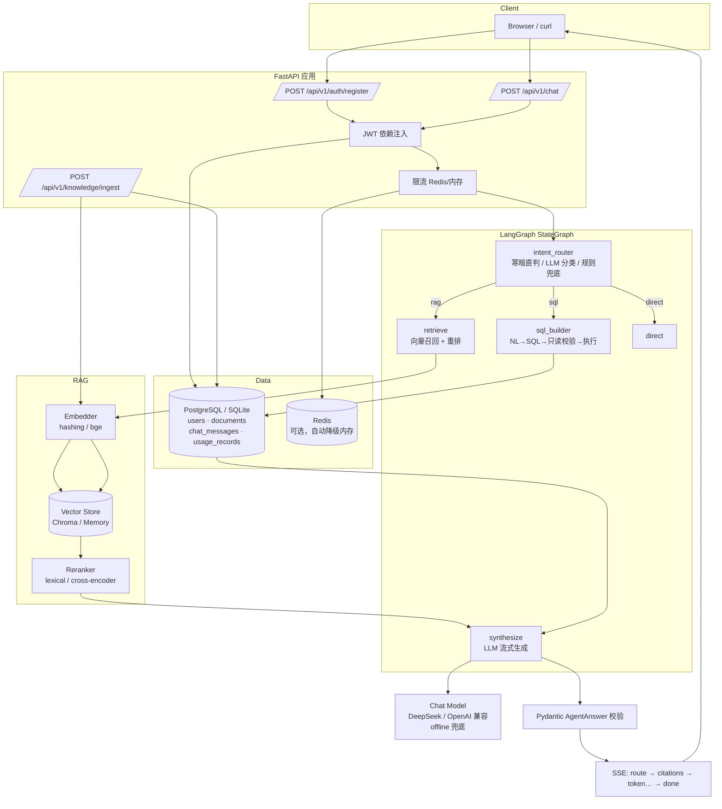
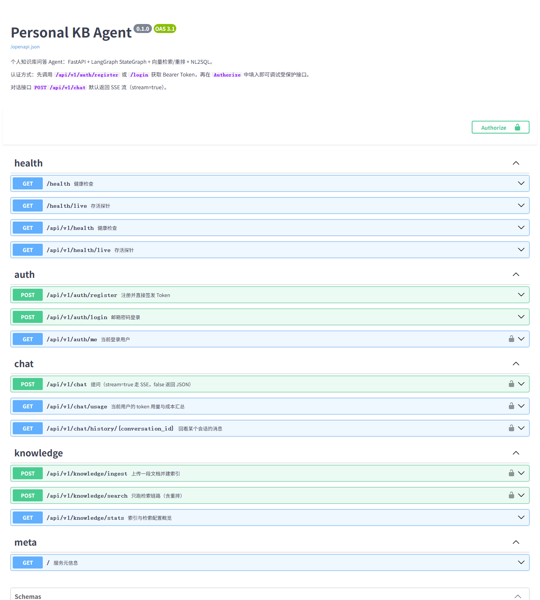
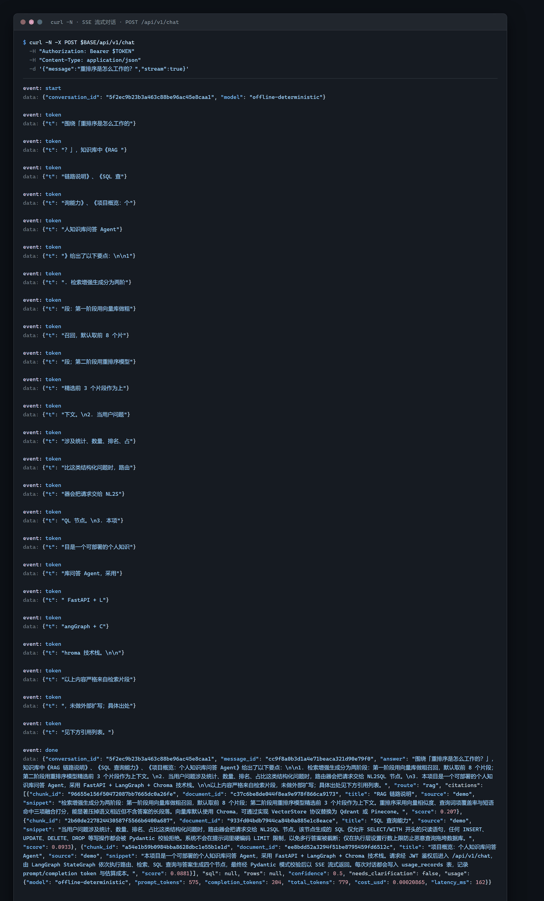
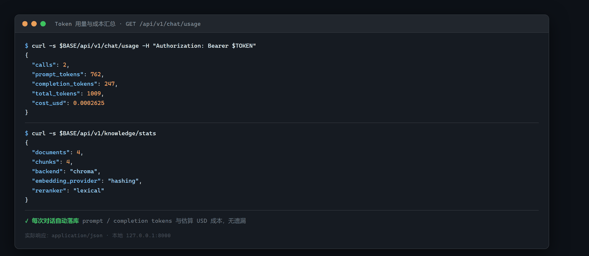

# Personal KB Agent · 个人知识库问答 Agent

一个可直接部署的个人知识库问答服务：**FastAPI + LangGraph StateGraph + 向量检索/重排 + NL2SQL**，
带 JWT 鉴权、SSE 流式输出、Token 成本台账，以及可一键启动的 Docker Compose 编排。

> 定位：求职作品 / 生产级 RAG 骨架。所有 Agent 产出必须通过 Pydantic 模式校验才会返回用户。

---

## 目录

- [核心能力](#核心能力)
- [架构](#架构)
- [技术栈](#技术栈)
- [快速开始](#快速开始)
- [文档摄入与检索验证](#文档摄入与检索验证)
- [接口示例](#接口示例)
- [SSE 事件协议](#sse-事件协议)
- [环境变量](#环境变量)
- [项目结构](#项目结构)
- [设计取舍](#设计取舍)
- [测试](#测试)
- [路线图](#路线图)
- [演示截图](#演示截图)

---

## 核心能力

| 能力 | 说明 |
|---|---|
| 对话问答 | 检索知识库 → 重排 → 生成，答案附**可追溯引用** |
| 流式输出 | SSE 逐 token 推送，首字延迟低；`stream=false` 可切一次性 JSON |
| NL2SQL | 统计类问题自动翻译成**只读** SQL 并执行，返回原始结果行 |
| 鉴权 | bcrypt 密码哈希 + JWT Bearer；注册即签发 Token |
| 成本可控 | 每次调用记录 prompt/completion token 与估算 USD 成本；上下文只带最近 N 轮 |
| 韧性 | 所有外部 I/O 强制超时 + 指数退避重试，失败降级而非 5xx |
| 可替换 | 向量库（Chroma/Qdrant/Pinecone）、Embedding、Reranker、LLM 均为可插拔实现 |

**零 Key 可跑**：默认 `LLM_PROVIDER=fake` 使用离线确定性模型，不需要任何 API Key
就能跑通全链路、跑通测试、看到流式效果。切真实模型只需改环境变量。

---

## 架构



**请求时序（RAG 路线）**

```
client ──POST /chat──▶ auth ─▶ 限流 ─▶ 读最近 N 轮 ─▶ intent_router
                                                        │  route 事件
                        ┌───────────────────────────────┘
                        ▼
              retrieve → rerank → 组装 context ──▶ citations 事件
                        │
                        ▼
              synthesize（LLM 流式）── token 事件逐个下发 ──▶ client
                        │
                        ▼
              AgentAnswer 校验 ─▶ 落库 + 计费 ─▶ done 事件（含 citations）
```

---

## 技术栈

| 层 | 选型 | 备注 |
|---|---|---|
| Web | FastAPI（异步）+ Uvicorn | 自动 OpenAPI，`/docs` 可直接调试 |
| Agent 编排 | LangGraph `StateGraph` | 条件边路由，节点职责单一；`intent_router`/`retrieve`/`synthesize` |
| LLM | DeepSeek `deepseek-chat`（OpenAI 协议） | 换网关只改 `OPENAI_BASE_URL`；`LLM_PROVIDER=fake` 时走离线确定性模型 |
| RAG | 向量召回 + 重排 | Embedding / 向量库 / Reranker 三层可替换 |
| Embedding | fastembed（ONNX）+ `BAAI/bge-small-zh-v1.5` | 512 维，权重约 90MB，走 hf-mirror；不依赖 torch |
| 向量库 | Chroma（默认） | 集合名按模型维度版本化；装不上自动降级进程内实现 |
| 关系库 | PostgreSQL + SQLAlchemy 2.0 | 异步驱动 asyncpg；本地默认 SQLite |
| 迁移 | Alembic | `alembic upgrade head` |
| 缓存/限流 | Redis | 连不上自动降级内存，`/health` 会标 degraded |
| 认证 | JWT（PyJWT）+ bcrypt | 不使用 passlib，规避其与 bcrypt 4.x 的兼容问题 |
| 流式 | SSE + `stream_mode="messages"` | 关闭 nginx 缓冲（`X-Accel-Buffering: no`） |
| 测试 | pytest + pytest-asyncio + httpx | 覆盖认证、RAG、NL2SQL、SSE、守卫 |
| 部署 | Docker Compose | api + postgres + redis；配置就绪，待本机 Docker 环境可用后验证 |

---

## 快速开始

### 方式一：Docker Compose（一键）

> **状态：配置就绪，待本机 Docker 环境可用后验证。**
>
> `Dockerfile` 与 `docker-compose.yml` 已按生产路径写好（多阶段构建、非 root 运行、启动前执行 `alembic upgrade head`、健康检查串联启动顺序），但开发本机当时没有可用的 Docker daemon，因此这条路径**尚未实际跑通**。下方命令是设计意图，首次使用请以实际输出为准；本地已完整验证的是下方的「方式二」。

```bash
cp .env.example .env
docker compose up --build -d
docker compose logs -f api
```

服务就绪后：

- Swagger UI: <http://localhost:8000/docs>
- 健康检查: <http://localhost:8000/health>

首次启动会自动执行 `alembic upgrade head` 建表，并灌入 4 篇演示语料。

### 方式二：本地开发

```bash
python -m venv .venv
# Windows
.venv\Scripts\activate
# macOS / Linux
source .venv/bin/activate

pip install -r requirements.txt
cp .env.example .env

# 首次运行会把 bge-small-zh 的 ONNX 权重（约 90MB）下到 ./data/models
# 走 hf-mirror.com 镜像，国内网络通常 30 秒内完成
python -m scripts.ingest

# 启动（默认 SQLite + Chroma + fastembed 真实语义向量）
uvicorn app.main:app --reload --port 8000
```

> 完全离线或 CI 环境可把 `.env` 里的 `EMBEDDING_PROVIDER` 设成 `hashing`（零依赖、非语义），
> 或 `VECTOR_BACKEND=memory` 走进程内向量库 —— 两条降级路径都不需要联网。

接真实大模型（DeepSeek / 通义 / vLLM / Azure，只要兼容 OpenAI 协议）：

```bash
pip install -r requirements-llm.txt
```

然后在 `.env` 里填：

```dotenv
LLM_PROVIDER=openai
OPENAI_API_KEY=sk-xxxxxxxxxxxxxxxxxxxxxxxxxxxxxxxx
OPENAI_BASE_URL=https://api.deepseek.com/v1
MODEL_NAME=deepseek-chat
```

> Key 只写进 `.env`（已被 `.gitignore` 排除），`.env.example` 里只有占位符。
> 换成 DeepSeek 后记得同步 `PRICE_PROMPT_PER_1K` / `PRICE_COMPLETION_PER_1K`，
> 否则用量台账里的美元数字是 OpenAI 的价格。

### 端到端验证（真实流式）

```bash
python -m scripts.e2e_chat
python -m scripts.e2e_chat "知识库里一共有多少篇文档？"
python -m scripts.e2e_chat --base-url http://127.0.0.1:8000   # 打已启动的服务
```

脚本跑的是完整链路：ASGI/HTTP → JWT → chat_service → LangGraph → DeepSeek → SSE，
逐帧解析并断言"真的流式、真的有引用"，任一断言不过就以非 0 退出。

### 冒烟验证

```bash
# 1) 注册拿 Token
TOKEN=$(curl -s -X POST http://localhost:8000/api/v1/auth/register \
  -H "Content-Type: application/json" \
  -d '{"email":"demo@example.com","password":"sup3rsecret!"}' | python -c "import sys,json;print(json.load(sys.stdin)['access_token'])")

# 2) 流式对话
curl -N -X POST http://localhost:8000/api/v1/chat \
  -H "Authorization: Bearer $TOKEN" \
  -H "Content-Type: application/json" \
  -d '{"message":"重排序是怎么工作的？","stream":true}'
```

---

## 文档摄入与检索验证

`docs/` 下的 Markdown / 纯文本会被切块写入 Chroma，检索命中时会带上**来源文件名、段落号、
字符区间、章节路径**四项元数据，可以精确回原文定位。

### 摄入

```bash
python -m scripts.ingest                     # 增量（已入库的跳过）
python -m scripts.ingest --force             # 强制重建（覆盖同名 source）
python -m scripts.ingest --dry-run           # 只看切块结果，不写库
python -m scripts.ingest --pattern "*.md"    # 只摄入匹配文件
```

脚本启动时会先打印本次实际生效的配置，避免"改了半天 .env 其实没读到"：

```
Embedder  : fastembed / BAAI/bge-small-zh-v1.5 (dim=512)
Collection: kb_documents_fastembed_baai_bge_small_zh_v1_5_512
Backend   : chroma
Chunk     : size=400 overlap=60
[1/1] kb-core-design.md  ok  title='...' chunks=5 elapsed=1.2s
汇总: 新增 1 篇 / 跳过 0 / 失败 0
本次新增切片 5 | 向量库总数 9 | 台账切片 9
```

单篇失败不会中断整批；结束时若"向量库条数"与"数据库台账条数"不一致，会自动触发重建并说明原因。

> 服务启动时还会灌 4 篇演示语料（`RAG 链路说明` / `SQL 查询能力` 等），让新 clone 的仓库
> 零配置就能问出东西。只想看到自己的文档时把 `SEED_DEMO_DOCS` 设为 `false`。

### 检索验证

```bash
python -m scripts.test_retrieval "不可违反的工程约束有哪几条？"
python -m scripts.test_retrieval --top-k 10 --top-n 5 --no-rerank "重排序怎么做"
python -m scripts.test_retrieval --verify "SQL 为什么禁用硬编码 LIMIT"   # 回查原文偏移
```

输出（真实运行结果）：

```
#1  rerank=0.6034  vector=0.6388  text
    source : kb-core-design.md
    title  : Personal KB Agent 个人知识库问答系统核心设计文档
    section: Personal KB Agent 个人知识库问答系统核心设计文档 > 四、不可违反的工程约束
    para   : #10   chars=[968,1342)  len=374
    偏移校验: ✅ content[char_start:char_end] == 切片文本
    preview: ## 四、不可违反的工程约束 1. **强制输出校验**：所有 Agent 的输出必须经过...
```

同时给出 `rerank`（融合分，最终排序依据）与 `vector`（余弦相似度）两个分数：
两者不一致的条目正是重排起作用的地方。`--verify` 会拿 `char_start/char_end` 回查数据库原文，
校验"落库时记的偏移"与"当时切的文本"完全一致 —— 这是引用能高亮的前提。

### 切分策略

按**结构**切，不按固定字数暴力切：

- Markdown 标题、围栏代码块、表格各自成块，代码块和表格不会被拦腰截断，`kind` 一并入库（`text` / `code` / `table`）；
- 超长块走滑窗，但若已在新行断开就不再叠加 overlap（避免产生 50 字左右的碎片）；
- 窗口起点前移到最近的句子边界（`\n。！？；`），不会出现从半个词开始的切片；
- 纯标题块并入紧随其后的正文块 —— 否则检索会命中一个只有 13 字标题的"幽灵片段"；
- 强制不变量：`content[char_start:char_end] == chunk.text`，由测试守护。

块长默认 400 字符、重叠 60。`bge-small-zh-v1.5` 上下文 512 token，中文接近 1 字 1 token，
留出的余量是为了避免 tokenizer 静默截断尾部。

---

## 接口示例

### 注册 / 登录

```bash
curl -X POST http://localhost:8000/api/v1/auth/register \
  -H "Content-Type: application/json" \
  -d '{"email":"demo@example.com","password":"sup3rsecret!"}'
```

```json
{
  "access_token": "eyJhbGciOiJIUzI1NiIs...",
  "token_type": "bearer",
  "expires_in": 86400,
  "user": {"id": "9f2c...", "email": "demo@example.com", "is_active": true, "created_at": "2026-11-10T07:10:00Z"}
}
```

### 非流式提问

```bash
curl -X POST http://localhost:8000/api/v1/chat \
  -H "Authorization: Bearer $TOKEN" \
  -H "Content-Type: application/json" \
  -d '{"message":"重排序是怎么工作的？","stream":false}'
```

```json
{
  "conversation_id": "0b9c...",
  "message_id": "4d1e...",
  "answer": "围绕「重排序是怎么工作的？」，知识库中《RAG 链路说明》给出了以下要点：\n\n1. 检索增强生成分为两阶段：第一阶段用向量库做粗召回，默认取前 8 个片段...",
  "route": "rag",
  "citations": [
    {"chunk_id": "a1b2...", "document_id": "7c3d...", "title": "RAG 链路说明", "source": "demo", "snippet": "检索增强生成分为两阶段...", "score": 0.87}
  ],
  "sql": null,
  "rows": null,
  "confidence": 0.87,
  "needs_clarification": false,
  "usage": {"model": "offline-deterministic", "prompt_tokens": 412, "completion_tokens": 96, "total_tokens": 508, "cost_usd": 0.00012, "latency_ms": 38}
}
```

### 自然语言触发 SQL

```bash
curl -X POST http://localhost:8000/api/v1/chat \
  -H "Authorization: Bearer $TOKEN" \
  -H "Content-Type: application/json" \
  -d '{"message":"知识库里一共有多少篇文档？","stream":false}'
```

```json
{
  "route": "sql",
  "sql": "SELECT count(*) AS total_documents FROM documents",
  "rows": [{"total_documents": 4}],
  "answer": "针对「知识库里一共有多少篇文档？」，我把问题转换成了只读 SQL 并执行，共返回 1 行结果：\n\n- {'total_documents': 4}",
  "citations": []
}
```

### 上传文档

```bash
curl -X POST http://localhost:8000/api/v1/knowledge/ingest \
  -H "Authorization: Bearer $TOKEN" \
  -H "Content-Type: application/json" \
  -d '{"title":"团队规范","content":"提交前必须跑 pytest。","source":"wiki"}'
```

### 其他

| 方法 | 路径 | 说明 |
|---|---|---|
| GET | `/health` | 依赖健康度（db / 向量库 / 缓存 / llm） |
| GET | `/health/live` | 存活探针，不碰外部依赖 |
| GET | `/api/v1/auth/me` | 当前用户 |
| GET | `/api/v1/chat/usage` | Token 与成本汇总 |
| GET | `/api/v1/chat/history/{conversation_id}` | 回看会话 |
| POST | `/api/v1/knowledge/search` | 只跑检索链路（含重排） |
| GET | `/api/v1/knowledge/stats` | 索引与检索配置概览 |

---

## SSE 事件协议

`POST /api/v1/chat`（`stream=true`）返回 `text/event-stream`：

```
event: start
data: {"conversation_id":"0b9c...","model":"deepseek-chat"}

event: route
data: {"route":"rag","source":"llm","reason":"询问设计原因需查文档"}

event: citations
data: {"citations":[{"source":"kb-core-design.md","paragraph_index":10,"char_start":968,"char_end":1342,"score":0.4356}]}

event: token
data: {"t":"禁止在 SQL 提示词里硬编码 LIMIT，"}

event: token
data: {"t":"是为了避免多行答案被截断。"}

event: done
data: {"conversation_id":"0b9c...","message_id":"4d1e...","answer":"...","route":"rag","citations":[...],"usage":{...}}
```

| 事件 | 时机 | 载荷 |
|---|---|---|
| `start` | 流开始 | `conversation_id`, `model` |
| `route` | 意图确定后、正文之前 | `route`, `source`(`llm`/`fast_rule`/`fallback`), `reason` |
| `citations` | 检索完成、正文之前 | `citations[]`（来源、段落号、字符区间、分数） |
| `token` | 每个增量 | `{"t": "文本片段"}` |
| `done` | 正常结束 | 完整 `ChatResponse`（含引用、SQL、rows、usage） |
| `error` | 异常 | `{"code","message"}`，客户端应停止拼接 |

前端对接要点：`done` 覆盖所有结构化字段，`token` 只用于实时打字效果；
若中途收到 `error`，丢弃已拼接内容并提示重试。

`route` 与 `citations` 都在第一个 `token` 之前到达，所以界面可以先把
"走的是哪条链路"和"依据了哪几个文档段落"渲染出来，再流式填正文。
`source=llm` 表示意图由模型判定，`fast_rule` 是寒暄直判，`fallback` 是模型不可用后回落规则。

---

## 环境变量

完整清单见 [`.env.example`](.env.example)。关键项：

| 变量 | 默认 | 说明 |
|---|---|---|
| `SECRET_KEY` | 占位值 | **生产必须替换**（`secrets.token_urlsafe(48)`） |
| `DATABASE_URL` | `sqlite+aiosqlite:///./data/app.db` | Compose 下覆盖为 PostgreSQL |
| `AUTO_CREATE_TABLES` | `true` | 生产设 `false`，改用 Alembic |
| `REDIS_URL` | 空 | 留空 = 进程内存缓存 |
| `VECTOR_BACKEND` | `auto` | `auto` / `chroma` / `memory` |
| `CHROMA_COLLECTION` | `kb_documents` | 基础名；fastembed 会派生带模型维度的后缀 |
| `EMBEDDING_PROVIDER` | `fastembed` | `hashing` 零依赖兜底 / `fastembed` ONNX / `sentence-transformers` 需 torch |
| `EMBEDDING_MODEL` | `BAAI/bge-small-zh-v1.5` | 中文小模型，512 维，权重约 90MB |
| `HF_ENDPOINT` | `https://hf-mirror.com` | 国内镜像；代码里也会 `setdefault`，双保险 |
| `FASTEMBED_CACHE_DIR` | `./data/models` | 权重落地目录，Compose 下挂卷复用 |
| `RAG_TOP_K` / `RAG_RERANK_TOP_N` | `8` / `3` | 粗召回条数 / 精排保留条数 |
| `RAG_CHUNK_SIZE` / `RAG_CHUNK_OVERLAP` | `400` / `60` | 块长与重叠，需给 512 token 留余量 |
| `RAG_MODEL_LOAD_TIMEOUT_SECONDS` | `600` | 首次下载模型用，**不能**复用 `TOOL_TIMEOUT_SECONDS` |
| `SEED_DEMO_DOCS` | `true` | 启动时灌 4 篇演示语料；只想看自己 `docs/` 的内容就设 `false` |
| `LLM_PROVIDER` | `fake` | `fake` = 离线确定性；`openai` = 任何 OpenAI 兼容网关（DeepSeek 用这个） |
| `MODEL_NAME` / `LLM_MODEL` | `deepseek-chat` | 两种写法都认；DeepSeek 官方示例用 `MODEL_NAME` |
| `OPENAI_API_KEY` / `LLM_API_KEY` | 空 | 真实模型的 Key，**只写在 `.env` 里，`.env` 已被 gitignore** |
| `OPENAI_BASE_URL` / `LLM_BASE_URL` | 空 | DeepSeek 填 `https://api.deepseek.com/v1` |
| `LLM_TIMEOUT_SECONDS` | `90` | 正文生成超时；复用 `TOOL_TIMEOUT_SECONDS`(10s) 会掐断长答案 |
| `LLM_INTENT_TIMEOUT_SECONDS` | `20` | 意图分类是短任务，超时就回落规则路由 |
| `HISTORY_MAX_TURNS` | `6` | 上下文窗口（轮），防止成本失控 |
| `TOOL_TIMEOUT_SECONDS` / `TOOL_MAX_RETRIES` | `10` / `2` | 外部 I/O 超时与重试 |
| `RATE_LIMIT_PER_MINUTE` | `30` | 每用户每分钟请求上限 |
| `SQL_MAX_ROWS` | `200` | 执行层行数保护（**不是**提示词里的 LIMIT） |

---

## 项目结构

```
personal_kb_agent/
├── AGENTS.md                 # 工程约束（角色/技术栈/不可违反项/验收标准）
├── app/
│   ├── main.py               # 应用装配 + lifespan
│   ├── api/
│   │   ├── deps.py           # JWT 当前用户
│   │   └── v1/               # health / auth / chat / knowledge
│   ├── agents/               # 编排层（不碰 HTTP，不碰 SQL 细节）
│   │   ├── graph.py          # StateGraph 拓扑
│   │   ├── nodes.py          # intent_router / retrieve / sql / synthesize / direct
│   │   ├── state.py          # AgentState
│   │   ├── llm.py            # DeepSeek(OpenAI 协议) / offline 模型工厂 + 预热
│   │   └── prompts.py        # 提示词（SQL 提示词刻意不含 LIMIT）
│   ├── rag/                  # 检索层
│   │   ├── chunking.py       # 结构感知切分（标题/代码块/表格 + 字符偏移）
│   │   ├── embeddings.py     # fastembed / hashing / sentence-transformers
│   │   ├── vectorstore.py    # Chroma / memory（集合按模型维度版本化）
│   │   ├── reranker.py       # lexical / cross-encoder
│   │   ├── retriever.py      # 召回 → 重排 → 带偏移的引用
│   │   └── ingest.py         # 遍历 docs/ → 切块 → upsert → 台账
│   ├── core/                 # 横切关注点
│   │   ├── config.py errors.py security.py
│   │   ├── resilience.py     # 超时 + 重试
│   │   └── cache.py          # Redis/内存 + 限流
│   ├── db/                   # models / session / base
│   ├── schemas/              # auth / chat / agent（输出校验闸门）
│   └── services/             # chat_service / usage
├── alembic/                  # 迁移脚本
├── docs/                     # 知识库语料（Markdown / TXT）
├── tests/                    # pytest（认证/RAG/NL2SQL/SSE/切分/引用/编排）
├── scripts/
│   ├── ingest.py             # 摄入 docs/，打印生效配置与切块统计
│   ├── test_retrieval.py     # 单问句检索验证（分数 / 来源 / 偏移校验）
│   ├── e2e_chat.py           # 端到端真实问答（LangGraph → DeepSeek → SSE）
│   └── seed_demo.py          # 手动灌演示语料
├── Dockerfile
└── docker-compose.yml
```

分层红线：`api/` 只做协议转换，`services/` 编排业务流程，`agents/` 只关心推理与工具，
`rag/` 只管检索，`db/` 只认 ORM。**不存在**一个文件里同时出现路由、SQL 和检索。

---

## 设计取舍

这里是几个值得在面试里讲的点：

1. **为什么路由用规则而不是 LLM？** 分类任务窄（greeting / 聚合 / 其他），规则可解释、零成本、
   可单测、不会因为模型抽风把统计问题送进 RAG。真实场景可换成小模型分类器，接口不变。
2. **为什么 `LLM_PROVIDER=fake` 也是第一等公民？** 没有 Key 的评审者、CI、以及每一个新
   clone 的开发者都应该能立刻跑通。离线模型走的是标准 LangChain `BaseChatModel`，
   因此 `stream_mode="messages"` 的行为与真实模型完全一致 —— 流式链路不会"只在生产环境才暴露 bug"。
3. **SQL 为什么不在提示词里写 `LIMIT 10`？** 那会把"有多少条记录"这种问题的答案直接截断成 10。
   行数保护放在执行层（`SQL_MAX_ROWS`），并显式回报 `truncated` 标记，让上层知道"这是被截过的"。
4. **为什么 Pydantic 校验放在 service 而不是节点里？** 节点可以局部失败并降级；但**出口只有一个**，
   校验点就必须在出口。`validate_answer()` 是唯一放行函数，非法结构抛 `AgentOutputError`（502）而不是
   悄悄返回脏数据。
5. **向量库为什么允许降级到内存？** Chroma 依赖 `onnxruntime` 等重依赖，在某些平台装不上。
   降级让"跑不起来"变成"跑得慢一点"，同时 `/health` 会如实报告当前后端。
6. **为什么不用 passlib？** passlib 1.7.4 读取 `bcrypt.__about__` 在 bcrypt>=4.1 上会崩。
   直接调 `bcrypt` 三行代码，省掉一个长期踩坑源。
7. **为什么用 fastembed（ONNX）而不是 sentence-transformers？** 后者拖整条 torch 依赖链，
   冷装动辄几百 MB、十几分钟；fastembed 只复用 `onnxruntime`，同一个 `bge-small-zh-v1.5`
   在 512 维下语义效果一致，`pip check` 也不会带进 transformers 的版本冲突。
8. **为什么切分按结构而不是按字数？** 固定窗口会把代码块和表格拦腰切断，检索出来是一段无法阅读的残片。
   这里用 Markdown 标题 / 围栏 / 表格作硬边界，只在块内超长时才滑窗，并且保证
   `content[char_start:char_end] == chunk.text` —— 这条不变量让"引用回原文高亮"从愿望变成事实。
9. **为什么集合名要带模型名和维度？** 换 embedding 模型就换了向量空间，往旧集合里塞新向量不会报错，
   只会让检索结果悄悄变差（384 维 vs 512 维）。集合名内嵌 `provider_model_dim`，
   加上构造时的维度守卫和写入前校验，冲突在启动期就炸出来，而不是等线上发现召回率掉了。
10. **为什么 chunk_id 用 `sha1(document_id|index|text)` 而不是 uuid4？** 相同内容必须落同一个 id，
    否则重跑一次摄入就是一份重复数据。确定性 id + `upsert` 让摄入天然幂等，`--force` 才需要先删。
11. **意图路由为什么让模型判断，而不是纯正则？** 规则只认字面（"多少" + "文档"），
    问"文档里有几种检索策略，区别是什么"会被误判成 SQL。真实模型能读懂意图，
    但会超时、会返回脏格式，所以做成**级联**：寒暄正则直判（零成本）→ 模型分类（默认路径）
    → 规则兜底。三层都在同一个节点里，路由永远不会"无解"。
12. **为什么不能用"薄封装"包一层 OpenAI SDK？** LangGraph 的 `stream_mode="messages"`
    靠 `BaseChatModel` 的流式回调工作。早期实现里有个只转发 `astream` 的普通 Python 对象，
    看着能跑，实际一个 token 都推不出去 —— 客户端会等整段答案生成完才收到响应。
    现在直接返回 `ChatOpenAI`，它本身就是 `BaseChatModel`。
13. **为什么要把 LLM 预热放在启动期？** 首次构造 `ChatOpenAI` 要 8 秒左右
    （`import langchain_openai` 4.7s + openai SDK 客户端初始化 3.5s + tiktoken 词典下载 4.7s），
    这段成本放在第一个用户请求上，TTFT 会从 2.4 秒变成 9 秒。启动期打一次 1-token 请求，
    用户侧就只剩推理时间；顺带把 tiktoken 缓存固定到 `./data/tiktoken`，容器重启不必重下。

---

## 测试

```bash
pytest                # 全量（含 1 例需真实模型的 integration，默认跳过）
pytest -q tests/test_chat.py
pytest --cov=app      # 需 pip install pytest-cov
RUN_FASTEMBED_IT=1 pytest -m integration   # 真跑一次 ONNX 模型
```

覆盖范围：

| 文件 | 覆盖点 |
|---|---|
| `test_auth.py` | 注册/登录/重复邮箱/错误密码/JWT 往返/超长密码 |
| `test_rag.py` | 切块、分词、embedding 确定性、重排顺序、入库后可检索、引用结构 |
| `test_chunking.py` | 偏移不变量、代码块/表格不被切断、章节路径、段落号单调、确定性 id、标题必带正文 |
| `test_citation_meta.py` | 旧 payload 反序列化、新元数据字段、去重、脏元数据容错 |
| `test_fastembed_branch.py` | 注入式假模型不下载、前缀生效、缺包报错、未知模型报错 |
| `test_index_bootstrap.py` | `SEED_DEMO_DOCS` 开关、重复启动不重复灌语料、旧调用点兼容 |
| `test_chat.py` | 路由分类、RAG 带引用、NL2SQL 返回正确行、SSE 事件流、会话续接、`top_k` 透传 |
| `test_orchestration.py` | LLM 意图路由与回落、脏输出解析、真实 usage 入账、引用标记清理、SSE 事件顺序 |
| `test_guards.py` | 只读 SQL 校验、空答案拒绝、`route=sql` 必须带 SQL、提示词无 LIMIT |
| `test_usage.py` | token 估算、成本计算、台账累计、上下文窗口上限、限流 |
| `test_health.py` | 健康检查、存活探针、`/docs` 与 OpenAPI 可用 |

---

## 路线图

- [ ] 文档解析：PDF / DOCX / 网页抓取入库（当前仅文本）
- [ ] 多租户：文档按 `user_id` 隔离，检索时带 `where` 过滤
- [ ] 混合检索：BM25 + 向量加权融合（当前重排已含词项覆盖率）
- [ ] 评测集：Recall@K / MRR / 答案忠实度自动回归
- [ ] OpenTelemetry 链路追踪 + Prometheus 指标
- [ ] 前端：流式打字 + 引用高亮的对话界面

---

## 演示截图

以下截图均取自本地实际运行（`127.0.0.1:8000`，Chroma 向量库 + 离线确定性模型），不是设计稿。

### Swagger UI · 全量接口



5 个分组（health / auth / chat / knowledge / meta）共 14 条接口，点开即调，鉴权走右上角 `Authorize`。

### SSE 流式对话



`curl -N` 的真实响应：`event: start` → 24 个 `event: token`（逐字到达，非一次性返回）→ `event: done`。
该次问答 prompt 575 + completion 204 = 779 tokens，耗时 162 ms，带 3 条知识库引用。

### Token 用量与成本汇总



每次对话自动写入一条 `usage_records`；`/api/v1/chat/usage` 按用户汇总调用次数、prompt/completion tokens 与估算 USD 成本，无需额外埋点。

---

## License

MIT
